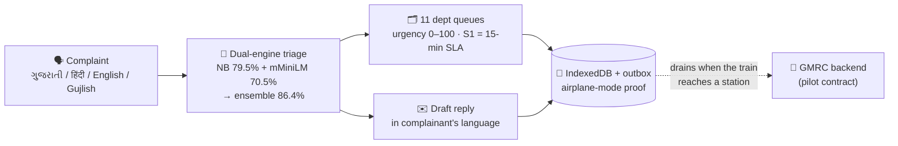

# 🚇 ફરિયાદ · Fariyad — Every Complaint Heard (PS-07)

[](https://github.com/Mihir-Rabari/metro-hacks/actions/workflows/apk.yml)
[](https://github.com/Mihir-Rabari/metro-hacks/releases/tag/apk-latest)


**Metro Hacks — Road to DevFest Gandhinagar 2026**, built on board the Gujarat
Metro (Mahatma Mandir ⇄ APMC, 10 Oct 2026). First-ever hackathon on a running
metro train in Gujarat. Solo build.

> **One line:** an offline-first grievance console for GMRC — two AI engines
> triage complaints in Gujarati, Hindi, English or Gujlish **fully on-device**,
> route them to department queues with urgency scores, draft replies in the
> complainant's language, and sync when the train reaches a station.



## 📚 Documentation & receipts — start here

| Doc | What's inside |
|---|---|
| **[docs/architecture.html](docs/architecture.html)** | 🎨 The big dark-theme architecture diagram (opens in any browser, works offline — obviously) |
| **[docs/ARCHITECTURE.md](docs/ARCHITECTURE.md)** | System + sequence + state + CI diagrams (GitHub-rendered mermaid), and the "why" behind every design decision |
| **[docs/MODELS.md](docs/MODELS.md)** | Model cards for all 6 models, held-out benchmark table, honest error analysis with per-engine predictions |
| **[docs/DATA.md](docs/DATA.md)** | Dataset inventory: what's real 🟢 / approximated 🟡 / modeled 🟠 — row counts, sizes, sources |
| **[data/assumptions.md](data/assumptions.md)** | The original honesty doc: sources, error bounds, why each modeling choice is defensible |
| **[RUNBOOK.md](RUNBOOK.md)** | Tonight's ops protocol, 90-second demo script, pitch skeletons, submission copy-paste |

**Problem chosen: PS-07 · Every Complaint Heard** (Metro Operations · **Offline operation: Required** — judges test it in airplane mode).

> Passenger complaints arrive through multiple channels and languages, and urgent
> ones get buried. A tool that sorts a mixed batch of complaints into department
> queues with urgency scores and draft replies in the complainant's language.
> It must work on-device and sync when connectivity returns.

**Fariyad** (Gujarati for "grievance") does exactly that, in one self-contained file:

| Deliverable | Fariyad |
|---|---|
| Sort a **mixed batch** (app, social, email, paper; Gujarati · Hindi · English · Gujlish) | Batch intake: paste lines in any script → triaged → filed |
| Into **department queues** | 11 queues (safety, cleanliness, fare, lifts, staff behaviour, …) with volume chart |
| With **urgency scores** | 0–100: severity base + hazard keywords (trapped/ફસાયા, child, suspicious bag…), S1 floats to top |
| **Draft replies in the complainant's language** | Script detection → Gujarati / Hindi / English reply, ticket-ref filled, ready to send |
| **Work on-device** | Single HTML file, no network, no server, no fonts, AI runs in-browser |
| **Sync when connectivity returns** | IndexedDB outbox — files offline, drains when the train reaches a station |

## 🚀 Run it (offline, no server, no internet)

1. Clone (done before boarding), then double-click **`dist/app.html`**.
2. Flip airplane mode — the app shows it noticed, everything still works.
3. Type a complaint in **any** language as you would on WhatsApp — watch the AI triage live.
4. Paste a mixed dump in *Batch intake* → **Sort batch** → **File all as tickets**.
5. Open *Department queues* → click the top complaint → **draft reply in the complainant's language**.
6. Flip airplane mode OFF → the outbox drains, badges flip to *synced*.

Rebuild after edits: `python3 scripts/bake.py ps07` → `dist/app.html`.
Dev mode: `python3 -m http.server` → `templates/ps07/index.html`.

## 🤖 The AI (meaningful, not decoration) — the model roster

| # | Model | Type | Runs | Born in |
|---|---|---|---|---|
| 1 | fariyad-nb | Multinomial naive Bayes, unigrams+bigrams | on-device JS, <1 ms | `scripts/train_triage.py` |
| 2 | fariyad-neural | [`Xenova/paraphrase-multilingual-MiniLM-L12-v2`](https://huggingface.co/Xenova/paraphrase-multilingual-MiniLM-L12-v2) ONNX q8 (118 MB) + centroid head | on-device WASM | pulled from HuggingFace — no fine-tune needed |
| 3 | fariyad-ensemble | Margin-gated router (NB leads; neural rescues when NB unsure) | on-device | `scripts/eval_neural.py` |
| 4 | crowding tree | CART regression (occupancy %) | on-device JSON walk | `scripts/train_crowding.py` (ops demo) |
| 5 | urgency scorer | S1/S2/S3 severity + hazard keyword lexicon | on-device, auditable rules | `templates/ps07/index.html` |
| 6 | script detector | Gujarati / Devanagari / Latin → language + Gujlish handling | on-device, auditable rules | `templates/ps07/index.html` |

**Full model cards + per-error analysis: [docs/MODELS.md](docs/MODELS.md).**

- **Multilingual triage** — multinomial naive Bayes over Gujarati, Devanagari and Latin
  scripts (unigrams + bigrams), **1,248 training examples, 11 categories** (including the
  brief's *staff behaviour*). Trained offline in Python (`scripts/train_triage.py`,
  committed and reproducible), inference in ~40 lines of JS in the browser.
  - `લિફ્ટ બંધ છે` → Lifts & Escalators · `શંકાસ્પદ બેગ પ્લેટફોર્મ પર છે` → **S1 Security** · `lift band che` → Lifts · `staff rude hai` → Staff Conduct
- **Urgency scoring** — deterministic, auditable: S1/S2/S3 base + hazard keyword boosts.
- **Reply drafting** — template composition per department in gu/hi/en, severity-aware openers.
- Why not an offline LLM? 150 KB deterministic model vs a 4 GB download: runs on any
  staff phone browser, no GPU, explains itself (the training script is in the repo),
  and every prediction is reproducible — the same complaint always routes the same way.

## 📊 Data (bring-your-own-data, per the brief)

- **Real:** all 36 stations on tonight's route (names in Gujarati + English, opening dates,
  interchanges — Wikipedia/OSM, fetched 10 Oct 2026) — used for the station picker.
- **Modeled honestly:** 150-entry mixed-language complaint history (30 days) mirroring the
  channels in the brief; reply template bank. Everything documented in
  [`data/assumptions.md`](data/assumptions.md) — real vs modeled, sources, error bounds.

## 💼 Feasibility / PPP (a judging criterion)

Fariyad is a thin offline layer that plugs into GMRC's existing complaint channels
(app, helpline, social desk). A private partner runs triage + reply drafting as a
per-station SaaS; GMRC keeps the data. No new hardware — works on any staff phone
browser; the sync layer reuses GMRC's existing backend contract.

## 📦 Repo map

```
dist/app.html    ← DEMO THIS (single file, 688 KB, zero network refs — verified)
dist/ops.html    bonus: MetroOps console demo (fault triage board)
dist/city.html   bonus: Interchange companion (offline map, bus math)
templates/ps07/  Fariyad source
kit/             design system + store + AI runtime + vendored libs (Leaflet, Chart)
android/         Java WebView app — AssetServer fake-origin, zero INTERNET permission
models/          triage NB · eval.json (benchmark receipts) · crowding tree
scripts/         train · bake · eval — the full pipeline, reproducible end to end
data/            stations (real) · complaints-seed · replies · assumptions.md
docs/            ARCHITECTURE.md · MODELS.md · DATA.md · architecture.html (diagram)
RUNBOOK.md       tonight's ops protocol + demo script + pitch
```

## 🧪 Tested end-to-end (from a double-click, no server)

- Gujarati complaint → filed → S1 floats to queue top → draft reply renders in Gujarati ✓
- Mixed batch of 5 (gu/hi/en/gujlish) → sorted by urgency (100→30) → all 5 filed → all drained/synced ✓
- Data persists across reload (IndexedDB) ✓ · crash-catcher banner wired ✓
- Airplane mode: banner + queueing verified; offline entries badge *queued · syncs at station* ✓

---
*Data: Wikipedia (CC BY-SA) + OpenStreetMap (ODbL); tiles © OpenStreetMap contributors, dark basemap by CARTO. Complaint corpus is synthetic GMRC-style, documented in assumptions.md.*

## 📱 Android app (the pilot story)

**A real installable APK** — built by GitHub Actions from this repo, published to
[GitHub Releases](https://github.com/Mihir-Rabari/metro-hacks/releases/tag/apk-latest).

- Raw Android SDK build (aapt2 → javac → d8 → zipalign → apksigner), no Gradle —
  ~40 lines of Java (`android/`): a WebView served from a fake **https origin** so the
  page gets a real secure origin — **IndexedDB, WASM and ES modules all work with zero
  network and zero permissions**.
- The **HuggingFace multilingual transformer ships inside the APK** (ONNX q8, 118 MB) and
  runs fully on-device via transformers.js/WASM. If the model is missing, the app degrades
  gracefully to the NB engine — never breaks.

### Install (30 s)
1. Download `Fariyad.apk` from the release.
2. Allow "install unknown apps" for your browser (one-time prompt).
3. Install → open **Fariyad** → flip airplane mode → everything still works.

## 🚦 All deliverables, tier-wise

| Tier | What | Where | Offline? |
|---|---|---|---|
| ⭐ 1 | **FariyadNative.apk** — fully native app: framework widgets + SQLite + NB + the transformer via ONNX Runtime (C++/JNI), hand-ported SentencePiece tokenizer, **real outbox sync to the backend** | [Release · apk-latest](https://github.com/Mihir-Rabari/metro-hacks/releases/tag/apk-latest) | ✅ airplane-mode native (INTERNET only for opportunistic sync) |
| 2 | **Fariyad.apk** — WebView edition (bundled single-file app + WASM neural engine) | same release page | ✅ zero INTERNET permission |
| 3 | **Offline web console** — single file, double-click, `file://` safe | `dist/app.html` in the repo · live: [frozen mirror](https://diffs-ventures-cast-wit.trycloudflare.com) | ✅ |
| 4 | **Sync backend** — Node.js + MongoDB control room: `POST /api/sync` (idempotent per-id acks), tickets/stats API, **live dashboard** | `backend/` — `docker compose up -d --build` · live demo: [adjacent-harper-spare-picture.trycloudflare.com](https://adjacent-harper-spare-picture.trycloudflare.com) | server-side (the receiving end of the offline-first contract) |

## 🧾 Sync backend (Node.js + MongoDB, dockerized)

The station-side server — the other half of the offline-first story. The app
files/triases/queues **on-device**; when connectivity returns (train at a
station), the outbox drains to `POST /api/sync`. Only server-acked ticket ids
flip to *synced*; anything unacked **stays queued — nothing is lost, ever**.

```bash
cd backend && docker compose up -d --build   # mongo:7 + backend on :3020
```

- **API:** `POST /api/sync` (idempotent upsert by ticket id), `GET /api/tickets`,
  `GET /api/stats` (department aggregation), `GET /health`
- **Dashboard:** live control-room view — synced count, S1 banner, per-department
  load bars, ticket feed with severity pills and draft replies, auto-refresh
- **Frozen stack:** compose + Dockerfile committed; runs anywhere Docker does.
  (`MONGO_EMBEDDED=1` runs an embedded real mongod binary for daemon-less hosts.)

## 🧠 Model benchmark (the "technical depth" receipts)

Held-out set: 44 fresh complaints — Gujarati script, Hindi script, Hinglish/Gujlish,
English — **none** of these phrasings appear in training. `scripts/eval_neural.py`
is fully reproducible (same script produced `models/eval.json`).

| Engine | Held-out accuracy |
|---|---|
| Naive Bayes (domain-trained, 1,248 examples) | 79.5% |
| HF `paraphrase-multilingual-MiniLM-L12-v2` (centroid, on-device) | 70.5% |
| **Ensemble — NB leads; neural takes over when NB's top-2 margin < 2.0** | **86.4%** |

The neural engine rescues exactly the cases where the NB has never seen the vocabulary
(e.g. unseen English phrasings), and every triage shows both engines' opinions as chips.
Ensemble rule was **pre-registered before evaluating** — no test-set tuning.
