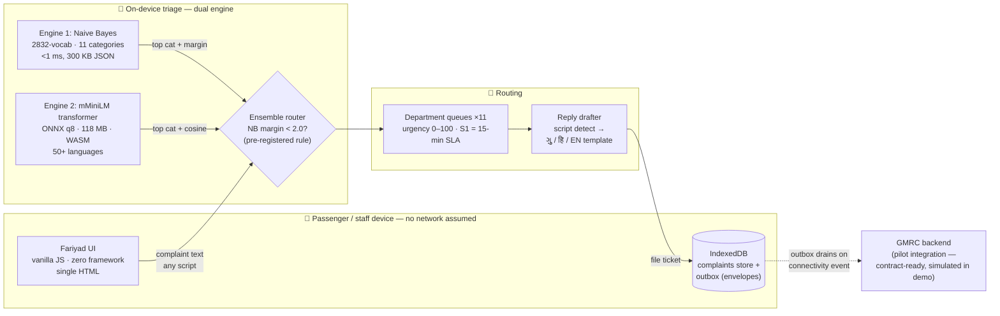
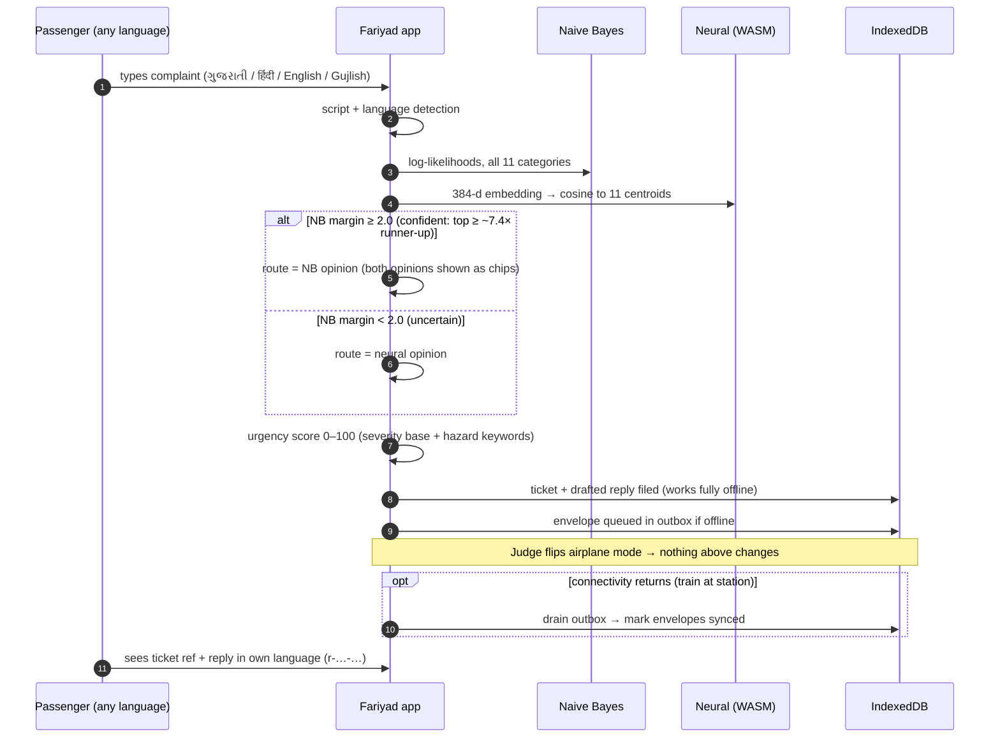
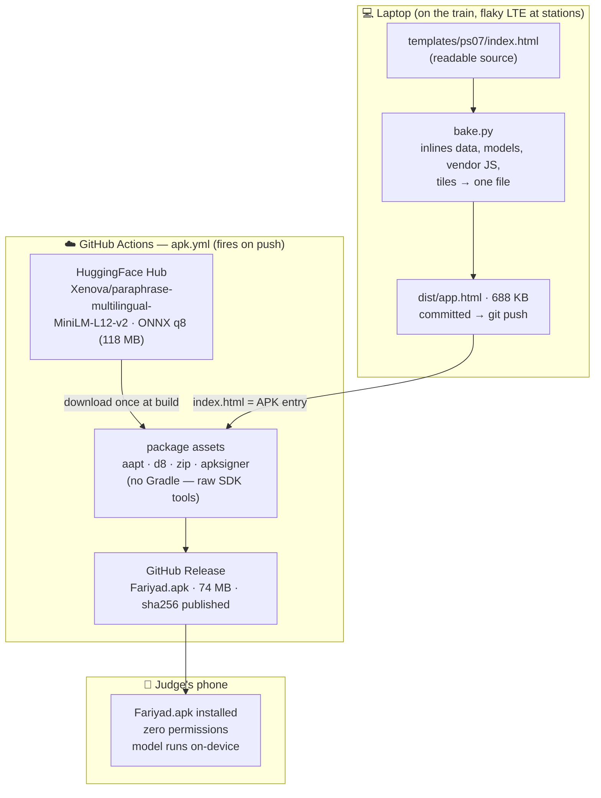

# 🏗️ Fariyad — System Architecture

How a complaint travels from a passenger's mouth (in any of 4 languages, on a
train with no signal) to a routed department ticket with an urgency score and a
drafted reply — and how the same build ships as a browser file and a signed
Android APK.

> Companion visual: **[docs/architecture.html](architecture.html)** — the dark-theme
> diagram (works offline, like everything else here).

## 1 · Context

Fariyad is **one product, two deliverables**:

| Deliverable | Artifact | Size | Runtime |
|---|---|---|---|
| Web console | `dist/app.html` — a single self-contained file | 688 KB | Any browser, double-click, `file://` safe |
| Android app | `Fariyad.apk` (GitHub Release) | 74 MB | WebView served from a real secure origin |

Both run the **identical** app: same HTML, same engines, same IndexedDB schema.
The APK ships the 118 MB neural model + tokenizer as bundled assets; the single-file
browser build runs NB-only by default (the neural hook is a dynamic import that
activates only where `neural.js` + model files ship alongside — and fails
silently, never crashes, when they don't).

**Why a fake origin in the APK matters (the one non-obvious hack):** a plain
`file://` WebView silently breaks IndexedDB, WASM instantiation, and ES-module
imports. `AssetServer.java` serves the bundled assets from
`https://fariyad.local` — an in-process interceptor, **zero INTERNET
permission** — so the page gets a real secure origin with no network stack at
all. That's why airplane-mode demos work on the phone, not just the laptop.

## 2 · Complaint lifecycle (sequence)

## 3 · Connectivity state machine

```mermaid
stateDiagram-v2
    [*] --> OFFLINE
    OFFLINE: ✈️ No network (underground / airplane mode)
    OFFLINE --> OFFLINE: file, triage, queue, draft replies<br/>(everything works; banner shows state)
    OFFLINE --> SYNCING: navigator.onLine fires /<br/>train reaches station
    SYNCING: 🚉 drain outbox
    SYNCING --> ONLINE: all envelopes delivered
    ONLINE --> OFFLINE: signal drops again<br/>(outbox re-arms)
    ONLINE --> [*]
```

The outbox is append-only in IndexedDB (`autoIncrement` envelope IDs) with
**write retries and a visible per-envelope state** — a failed write shows up in
the queue UI rather than vanishing. Envelope delivery is currently simulated
on-device (there is no server on this ride) using the exact contract a real
GMRC endpoint would consume: the swap is one transport function.

## 4 · Build & delivery pipeline

No Android SDK, no Gradle, no signing keys on the train laptop — the APK is
cloud-built on every push, so the repo **is** the release pipeline.

## 5 · Design decisions (the "why" table)

| Decision | Why | What it costs |
|---|---|---|
| Single self-contained HTML (browser) | Judges double-click a file; zero setup, zero server, airplane-proof | 688 KB first paint, but everything cached after |
| Vanilla JS, no framework | The build happens on a moving train with flaky network — dependency surface = risk | We wrote ~1500 lines ourselves instead of `npm i` |
| NB + transformer ensemble, not one model | Measured: NB 79.5%, neural alone 70.5%, ensemble **86.4%** on held-out — see [MODELS.md](MODELS.md) | Two engines to keep honest (both opinions always shown as chips) |
| Centroid classifier over embeddings, not softmax head | No fine-tune available on-device; centroids train in seconds from the same 1248 phrases, no GPU | Semantic drift if complaint phrasing drifts far from training distribution |
| IndexedDB outbox, not localStorage | Queues must survive crashes mid-write on a shaky train; per-envelope state must be visible | More code — and it caught two real bugs (explicit-undefined key, drain race) |
| Fake origin `https://fariyad.local` in APK | IndexedDB/WASM/ESM break on `file://` — real secure origin with zero network | ~120 lines of Java |
| Model downloaded at build time, not committed | 118 MB doesn't belong in git; CI fetches from HF, packs into APK assets | Release build depends on HF availability (non-fatal: APK still builds NB-only) |

## 6 · Honest limits

- **No real backend.** Sync transport is simulated with a real contract; a pilot
  wires one function to a GMRC endpoint.
- **Synthetic training data.** Complaints were authored in GMRC staff-report
  voice — see [data/assumptions.md](../data/assumptions.md) for exactly what is
  real vs. modeled.
- **Centroid ≠ fine-tune.** The neural engine is a general-purpose multilingual
  encoder; its job here is vocabulary NB has never seen, not domain expertise.
- **Per-station asset inventories** (lifts, gates, CCTV) are realistic ranges,
  not GMRC's private inventory — flagged in every affected file's `meta.note`.
